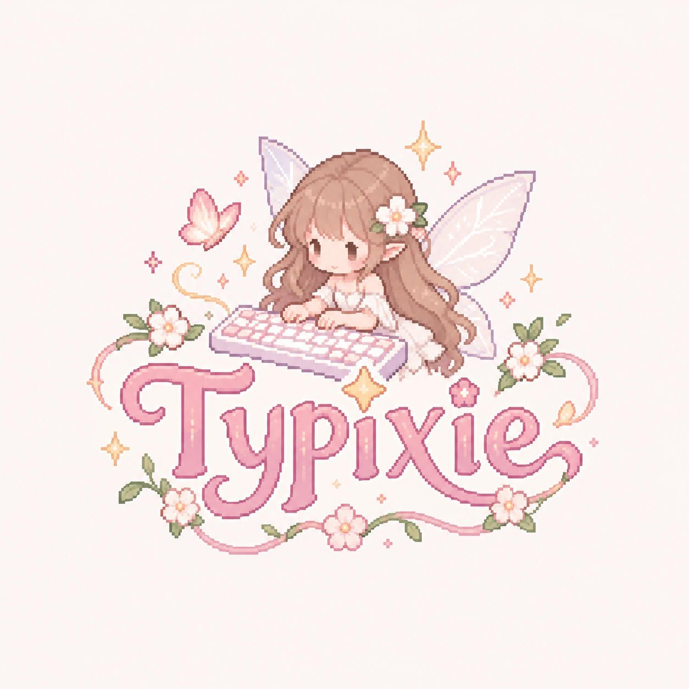

# Typixie

## ⚙️ Key Features

⌨️ Typing Test
> Take a timed typing test and measure your words per minute and accuracy — the faster and more accurate you type, the more you earn.

**✨ EXP & Leveling System**
> Earn experience points with every test you complete. Rack up enough EXP and level up your fairy rank!

**🧚 Fairy Points**
> Alongside EXP, collect Fairy Points as you type — a magical in-app currency that reflects your dedication and skill.

**🎁 Fairy Exchange**
> Spend your hard-earned Fairy Points to unlock and collect adorable fairies. The more you type, the more fairies you can collect!

**💖 Made for the Girlies**
> A soft, dreamy aesthetic with pastel visuals designed to make typing practice feel less like a chore and more like a vibe.

---

## 🌸 Try It Out

[Visit Typixie](https://typixiee.vercel.app/)

*No setup needed — just open the link and start typing!* 🧚‍♀️

